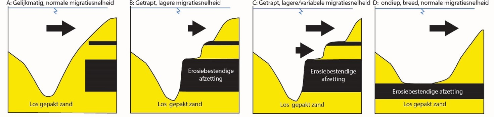
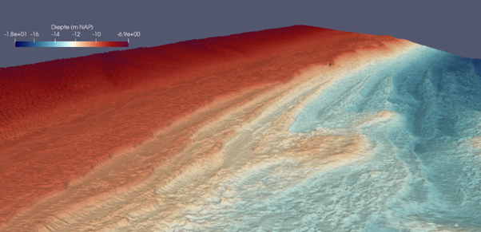
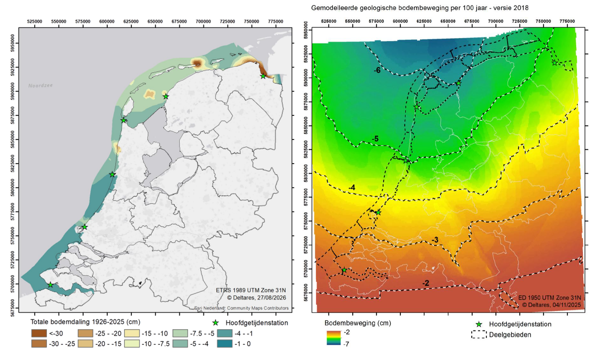

\newpage

# Geologie

```{r setupGeologie, include=FALSE}

```


## Geologische achtergrond Waddenzee {#geologie-achtergrond}

De ondiepe ondergrond van de Waddenzee ontstaan door een opeenvolging van verschillende omstandigheden (zoals ijstijden, afwisselend hoge of lage zeespiegel, open mariene omgeving of in een delta/rivier) en door verschillende processen ontstaan. De verschillende perioden hebben allemaal andere bodemlagen achtergelaten, die samen de huidige Waddenzee vormen.

**IJstijden**

Twee keer is dit gebied bedekt geraakt onder het landijs: tijdens het Elsterien glaciaal (465.000 -- 418.000 jaar geleden) en het Saalien glaciaal (238.000 - 126.000 jaar geleden). In het oostelijke gedeelte van de Waddenzee kunnen afzettingen uit het Elsterien worden gevonden. Het gaat hierbij om zanden maar ook klei die in grote smeltwatermeren werd afgezet. Deze klei wordt ook wel 'Potklei' genoemd en is zeer erosiebestendig. Lokaal beïnvloeden deze harde kleilagen nog altijd de morfologie in de Waddenzee. Voor de kust van Ameland ligt deze laag op de bodem van het Borndiep, en ook in de Eems is Potklei te vinden op de bodem van de geulen. Het effect van deze erosieresistente lagen wordt in paragraaf \@ref(erluitleg) verder uitgelegd. 

In de warme periode tussen de Elsterien en Saalien ijstijden (het Holsteinien interglaciaal) stond het gebied onder water en werden er voornamelijk fijnkorrelige, schelphoudende zandlagen afgezet. Bij de terugkeer van het landijs in het Saalien werd onder de gletsjers keileem afgezet: een erosiebestendige klei/leemlaag waarin ook grind en grotere keien aanwezig zijn. Deze keileem laag is later deels weer geërodeerd, maar een deel ervan is bewaard gebleven en wordt voornamelijk in het westelijke gedeelte van de Waddenzee aangetroffen, bijvoorbeeld rond Texel.

In de daarop volgende warme periode, het Eemien (126.000 -- 116.000 jaar geleden), drong de zee weer delen van het Waddenzeegebied binnen en werden op de zeebodem zand- en kleilagen afgezet. In de laatste ijstijd, het Weichselien (116.000 -- 11.700 jaar geleden) kwam het landijs niet verder dan Noord-Denemarken. De Waddenzee lag droog en veranderde in een toendralandschap. Er werd voornamelijk zand afgezet onder invloed van de wind, beken en smeltwater van de ten noorden gelegen ijskap.

**Holoceen**

Toen in het Holoceen (11.700 jaar geleden - heden) de zeespiegel steeg ontstond er kortstondig een veenmoeras door de verhoogde grondwaterstanden, waardoor er op de onderliggende zanden een laag veen ontstond die 'basisveen' wordt genoemd. Deze laag basisveen is op enkele plekken nog bewaard gebleven. Erboven wordt geregeld een kleilaag aangetroffen die onder de eerste mariene invloeden werd afgezet nadat de zeespiegel nog verder was gestegen. Deze opeenvolging van veen en klei vormt bijvoorbeeld de erosie-resistente laag in de geulwand van het Borndiep.

Naarmate de zee verder steeg en het getijdenbekken zijn huidige vorm kreeg zijn de oudere afzettingen geërodeerd en omgewerkt door migrerende getijdengeulen. Op veel plekken, met name waar de oudere lagen goed bestand zijn tegen erosie, zijn de lagen bewaard gebleven en kunnen ze nog steeds bepalend zijn voor de morfologische ontwikkeling van geulen.

## Erosieresistente lagen {#erluitleg}

De morfologie van de geulen in de Waddenzee wordt mede bepaald door de erosiegevoeligheid van het sediment waarin de geul zich verticaal insnijdt en lateraal beweegt. De geologie is om die reden onlosmakelijk verbonden aan de morfologische ontwikkeling van geulen. In het kader van het kustbeheer, en het (vaar)geulbeheer in het bijzonder, is het van belang om inzicht te hebben in waar erosieresistente lagen zich bevinden en welk effect ze hebben (gehad) op de morfologische ontwikkeling.

De ligging van deze erosieresistente lagen is in een eerder onderzoek [@Onselen2021] bepaald en is weergegeven in Figuur \@ref(fig:erl-kaart). De erosieresistente lagen zijn meestal kleilagen, maar ook veen, schelpen en grind kunnen moeilijk erodeerbaar zijn. De kaart toont plekken waar deze lagen actief invloed uitoefenen op de morfologische ontwikkeling van de bodem en is dus geen kartering van de verbreiding van de lagen zelf. Voor meer informatie over het gebruik en de totstandkoming van deze kaart wordt naar het oorspronkelijke onderzoek verwezen.


(ref:erl-kaartLabel) Interactieve kaart van erosie-resistente lagen in het Waddengebied. Klikken op een (mogelijke) ERL laat de verandering in dwarsdoorsnede in de loop van de tijd zien ([Link naar Schermvullende versie](https://www.testsysteemrapportage.nl/ERL%20kaart%20NL%20v1.0/index.html#10/53.2167/5.6978)). 

```{r erl-kaart, fig.cap= "(ref:erl-kaartLabel)"}

if(knitr::is_html_output())knitr::include_url("../ERL kaart NL v1.0/index.html#10/53.2167/5.6978", height = "600px") else{
  knitr::include_graphics(file.path(datadir, "deltares/geologie/erosieresistentelagen.png"))
}
```


### Effect van erosieresistente lagen op de morfologie

De effecten van erosieresistente lagen kunnen op verschillende manieren tot uiting komen in de morfologie, afhankelijk van de ligging van de lagen en de lokale hydrodynamische condities. In Figuur \@ref(fig:erl-morfologie) zijn de verschillende situaties schematisch weergegeven:

- **Erosieresistente laag aan zijkant geul:** Een geul die zich in (losgepakt) zand insnijdt zal een v-vormig dwarsprofiel vormen (Figuur \@ref(fig:erl-morfologie) A). Als één of meerdere erosieresistente lagen zich in de geulwand bevinden kan er een getrapt profiel ontstaan. Een dikke en/of sterk resistente erosieresistente laag in de geulwand zal ervoor zorgen dat de laterale migratie van de geul in meer of mindere mate wordt vertraagd ter hoogte van deze laag (Figuur \@ref(fig:erl-morfologie) B en C, Figuur \@ref(fig:erl-multibeam)). 

- **Erosieresistente laag op bodem geul:** Als er een erosieresistente laag op de bodem van de geul ligt en deze de verdieping van de geul verhindert, kan er een 'platte' bodem ontstaan. Dit is onder anderen zichtbaar in de Eems ten noorden van Eemshaven. De geul zal zich meer in de breedte ontwikkelen een u-vormig dwarsprofiel aannemen en voor een (tijdelijke) toegenomen erosiesnelheid zorgen (Figuur \@ref(fig:erl-morfologie) D). 

```{r erl-morfologie, fig.cap="Conceptueel model voor de mogelijke effecten van ERL\\'s op geulmorfologie."}


```


```{r erl-multibeam, fig.cap="In deze multibeam bathymetrie van de Westerscheldemonding is het ontstaan van het getrapte profiel duidelijk zichtbaar met kleilagen die uit de geulwand steken. De kleilagen liggen in dit voorbeeld niet perfect horizontaal, maar steken schuin weg de geulwand in (hellen naar links in het figuur), waardoor ze een soort richels vormen in de geulwand."}


```

\newpage

## Geologische bodemdaling {#geobodemdaling}

Langs de gehele kust van Nederland vindt relatieve zeespiegelstijging plaats. Een deel hiervan wordt veroorzaakt door een toename van het volume water in de oceaan, maar een deel ook door bodemdaling van het kustgebied zelf. Hierbij kan onderscheid gemaakt worden in bodemdaling veroorzaakt door de mens, bijvoorbeeld door het winnen van gas ( \@ref(winningbodemdaling)), en geologische bodemdaling. Met dit laatste wordt de langzame achtergronddaling bedoeld, veroorzaakt door tektonische bodemdaling langs breuken en door glacio-isostatische bodemdaling. Dit laatste is nog een gevolg van de laatste ijstijd. Er lag toen zoveel ijs in Noord-Europa dat daar de aardkorst ingedrukt werd en in zone daaromheen, inclusief Nederland, kwam de aardkorst juist omhoog. Hetzelfde proces treedt op bij het gaan liggen op een luchtbed in een zwembad, maar in tegenstelling tot een luchtbed, dat weer snel horizontaal ligt als de belasting verdwijnt, is de aardkorst nog steeds aan het terugveren nu het ijs in Noord-Europa verdwenen is. Hierdoor vindt in geheel Nederland nog steeds glacio-isostatische bodemdaling plaats.

De optelsom van tektonische en glacio-isostatische bodemdaling bepaalt de geologische bodemdaling. Deze berekening wordt uitgevoerd binnen de [Bodemdalingsmonitor (Deltares, 2026)](https://publications.deltares.nl/11212814_003_0001.pdf) voor het kustfundament en de getijdenbekkens. Figuur \@ref(fig:bodemdalingsmonitor-geologie) geeft de meest recente kaart van geologische bodemdaling voor Nederland voor een periode van 100 jaar. De gemiddelde snelheid van geologische bodemdaling wordt constant beschouwd op een schaal van eeuwen, dus de geologische bodemdaling in de laatste 100 jaar zal identiek zijn aan de geologische bodemdaling in de komende 100 jaar.

Op de kaart is een duidelijke overgang zichtbaar van zuid naar noord, met minder bodemdaling in het zuiden (rond 2 cm/eeuw) en meer in het noorden (rond 6 cm/eeuw). Deze trend wordt bepaald door glacio-isostatische bodemdaling, terwijl de meer regionale afwijkingen van de hoofdtrend het gevolg zijn van tektonische bodembewegingen.


```{r bodemdalingsmonitor-geologie, fig.cap="Links: totale bodemdaling, bestaande uit een combinatie van geologisch en winning delfstoffen over de afgelopen 100 jaar (Bodemdalingsmonitor 2026). Rechts: gemodelleerde geologische bodemdaling voor een periode van 100 jaar. Links:Voor geheel Nederland wordt bodemdaling gemodelleerd, toenemend van zuid naar noord van 2 tot 6 cm per eeuw. De zwart-witte lijnen zijn contourlijnen van geologische bodemdaling (Bodemdalingsmonitor 2022)."}


```
