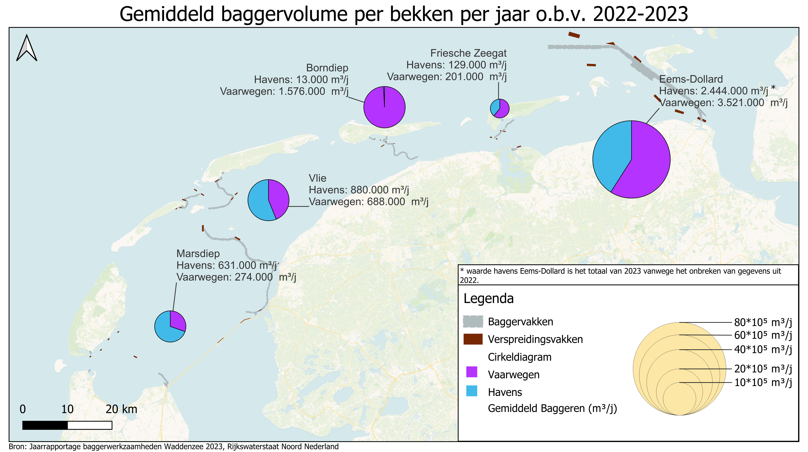
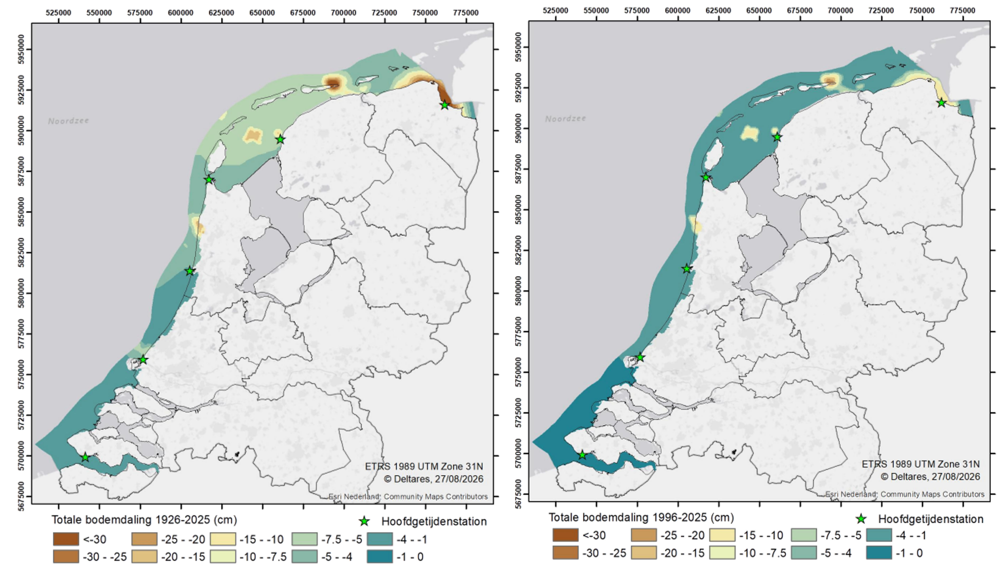
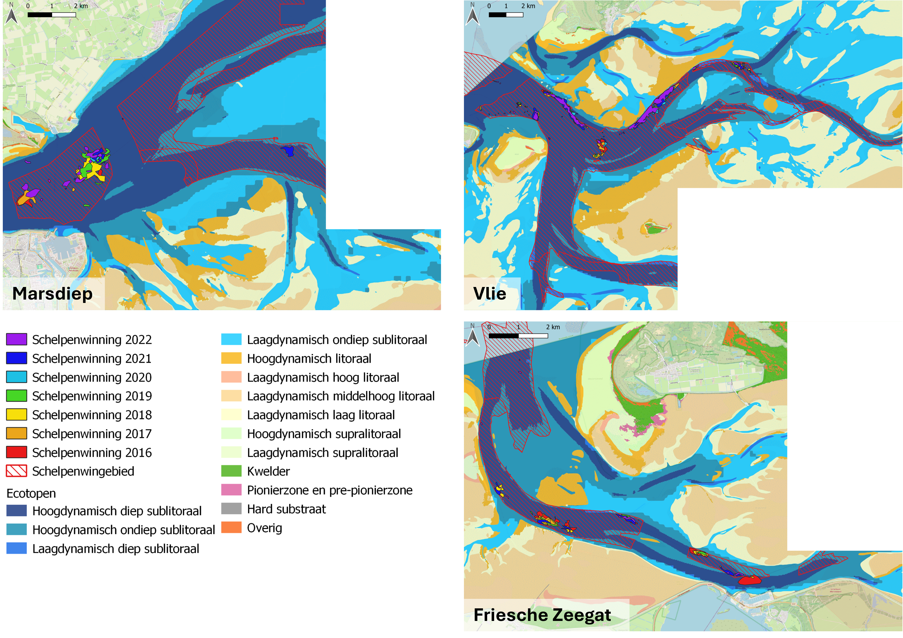
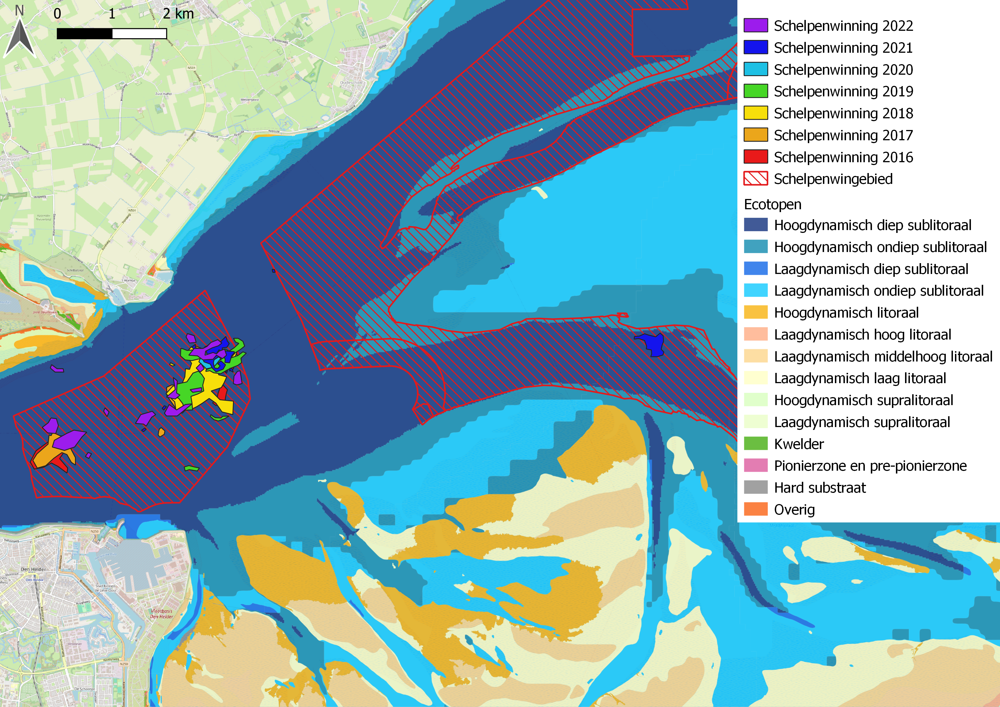
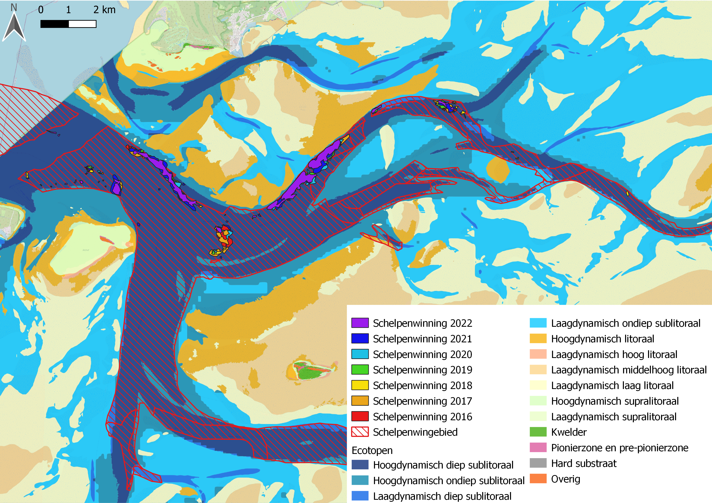
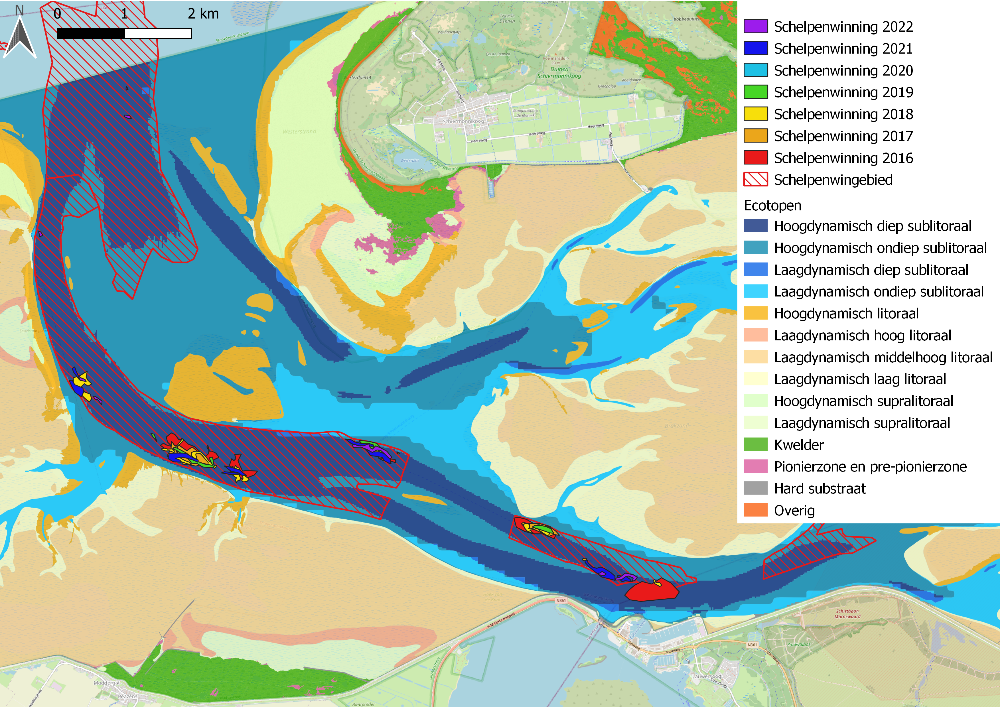

\newpage

# Ingrepen door de mens

De Waddenzee is één van de drukste natuurgebieden die we kennen. Menselijk medegebruik, zoals scheepvaart, visserij en de winning van delfstoffen vindt op veel plekken in de Waddenzee plaats. In de systeemrapportage zijn de menselijke ingrepen toegevoegd die relevant geacht worden voor de morfologische ontwikkeling van de
Waddenzee. Deze hebben betrekking op de ligging of verstoring van de
bodem, en/of op volumes door de mens verplaatst sediment. De volgende parameters zijn hier opgenomen:
- **Bagger- en verspreidingswerken:** Om de vaargeulen naar de havens en de eilanden bereikbaar te houden moet er op veel plaatsen in de Waddenzee worden gebaggerd. Hierbij wordt materiaal uit geulen verplaatst naar andere gebieden, waar het wordt verspreid. Om mee te kunnen groeien met zeespiegelstijging mag er tegenwoordig geen zand meer gewonnen worden uit de Waddenzee, dwz. al het gebaggerde materiaal wordt in de Waddenzee weer verspreid. In het verleden werd er wel zand gewonnen in de Waddenzee, wat relevant is om de historische ontwikkeling te begrijpen. Zodra er een goed overzicht is van historische zandwinning zal dit hier worden ontsloten.
- **Zandsuppleties:** Structurele zandsuppleties worden alleen uitgevoerd aan de noordzeezijde, maar een deel van dit sediment komt ook de Waddenzee binnen.
- **Bodemdaling:** Bodemdaling onder de Waddenzee bestaat uit een combinatie van natuurlijke (geologische) en door mensen veroorzaakte bodemdaling, door de winning van gas en zout onder de bodem. De bodemdalingsmonitor in paragraaf \@ref(winningbodemdaling) toont de bodemdaling over de afgelopen 30 jaar.
- **Kunstwerken**: Paragraaf \@ref(kunstwerken) toont een overzicht van dijken, sluizen en gemalen rondom de Waddenzee.
- **Gebieden gesloten voor bodemberoerende visserij:** Delen van de Waddenzee zijng esloten voor (bodemberoerende) visserij. Paragraaf \@ref(gebiedenGeslotenVisserij) geeft een overzicht van de gebieden gesloten voor bodemberoerende visserij in de Noordzee. Er bestaat helaas geen eenduidig overzicht van de visserij-activiteiten die in de Waddenzee plaatsvinden.
- **Schelpenwinning:** Paragraaf \ref(schelpenwinning) toont een overzicht van gebieden waar schelpenwinning is toegestaan en waar schelpenbanken zich bevinden.


## Bagger- en verspreidingswerken

Om de vaargeulen naar de havens en de eilanden bereikbaar te houden moet er op veel plaatsen in de Waddenzee worden gebaggerd. Al het gebaggerde materiaal wordt ook binnen de Waddenzee weer verspreid, om het sediment binnen het systeem te behouden met het oog op zeespiegelstijging. Dit verspreiden gebeurt op speciaal aangewezen verspreidingslocaties, veelal met hoge stroomsnelheden, waar het materiaal snel door het systeem wordt opgenomen. Een overzicht van de gebaggerde volumes per bekken wordt gegeven in Figuur \@ref(fig:baggeren20222023), waarin ook de locatie van de baggervakken en verspreidingsvakken staat aangegeven.

De vaarwegen worden onderhouden door Rijkswaterstaat, havens veelal door lokale beheerders. Een overzicht van baggervolumes per jaar kan worden gevonden in de door Rijkswaterstaat gepubliceerde jaarrapportages, bijvoorbeeld de [Jaarrapportage baggerwerkzaamheden Waddenzee 2025](https://open.rijkswaterstaat.nl//@301384/jaarrapportage-baggerwerkzaamheden/). Deze en eerdere jaarrapportages geven meer inzicht in variaties tussen
jaren en in de verdeling binnen een bekken. Daarnaast geeft de studie [Abiotische effecten baggeren en verspreiden in de Waddenzee (Deltares,
2024)](https://publicwiki.deltares.nl/display/MORFWAD/Producten?preview=/137135283/314311761/11210370-014-ZKS-0001_v1.0-Abiotische%20effecten%20baggeren%20en%20verspreiden%20in%20de%20Waddenzee%20-%20voor%20publicatie.pdf)
een goed overzicht van baggervolumes, trends, en de invloed van het baggeren op de Waddenzee. 

In het Marsdiep en het Vlie vormen de baggerwerken in de havens
(Marinehaven Den Helder, Harlingen) het grootste volume. In het Borndiep
is het in havens gebaggerde volume juist heel klein, en komt vrijwel het
gehele volume op het conto van de Veerbootroute Ameland-Holwerd. Het
baggervolume in Eems-Dollard is duidelijk het grootste van de
Waddenzeebekkens, waarbij vooral het baggervolume in de geulen sinds de
vaarwegverruiming in 2017/2018 aanzienlijk gegroeid is naar circa 3,5
miljoen m^3^ per jaar.

```{r baggeren20222023, fig.cap="Overzicht van bagger- en verspreidingslocaties en baggervolumes, gemiddeld over 2022 en 2023. De grootte van de cirkels geeft het volume per bekken weer; de kleur de herkomst (vaarweg of haven) van het materiaal. Bron: Abiotische effecten baggeren en verspreiden in de Waddenzee, Deltares (2024)"}


```

## Zandsuppleties

Structurele zandsuppleties worden alleen uitgevoerd aan de Noordzeezijde
van de eilanden en niet in de Waddenzee. Dit materiaal wordt vervolgens
door golven en getij door de zeegaten wel (deels) naar de Waddenzee
getransporteerd, en daar afgezet. Dit proces is belangrijk om
zeespiegelstijging te kunnen volgen. Locaties en volumes van structurele
suppleties zijn beschikbaar via de
[kustviewer](https://www.openearth.nl/coastviewer-static/). Het is 
niet precies bekend hoeveel van het gesuppleerde volume daadwerkelijk in de
Waddenzee terecht komt, dit is af te leiden uit de sedimentbalans. In de afgelopen jaren hebben ook enkele
incidentele suppleties plaatsgevonden in de Waddenzee zelf (bijvoorbeeld
de Prins Hendrik Zanddijk, de 'mudmotor' ten oosten van Harlingen) die
niet in de kustviewer staan, en daarom niet zijn ontsloten.

## Bodemdaling {#winningbodemdaling}

In de [Bodemdalingsmonitor (Deltares, 2026)](https://publications.deltares.nl/11212814_003_0001.pdf) is een overzicht gegeven van de opgetreden en verwachte bodemdaling als gevolg van de winning van gas, olie en zout. Figuur \@ref(fig:Bodemdaling) toont de totale bodemdaling over de afgelopen 100 jaar (links) en de afgelopen 30 jaar (rechts) als gevolg van geologische bodemdaling en daling door het winnen van delfstoffen. De grootschalige trend van geologische bodemdaling geeft ca 5.5 cm per eeuw in grote delen van de Waddenzee (lichtgroen vlak). Daarnaast zijn in de Waddenzee duidelijk de bodemdalingsschotels te zien als gevolg van de gaswinning rondom Delfzijl en de oostpunt van Ameland, en als gevolg van zoutwinning bij Harlingen.

Naast de afgelopen periode is ook een verwachting gemaakt voor de komende 30 jaar. Doordat de gaswinning in meerdere gebieden is beëindigd of sterk afneemt, worden de meeste bodemdalingsvolumes kleiner. Door na-ijlingseffecten blijft bodemdaling door gaswinning in de Waddenzee echter ook de komende 30 jaar nog relevant. Daarnaast is de verwachting dat het bodemdalingsvolume in het Vlie zal toenemen door de zoutwinning bij de Ballastplaat nabij Harlingen (Deltares, 2026).


```{r Bodemdaling, fig.cap="Totale bodemdaling over de afgelopen 100 jaar (links) en de afgelopen 30 jaar (rechts) als gevolg van geologische bodemdaling en daling door het winnen van delfstoffen. Bron: Bodemdalingsmonitor (Deltares, 2026)"}


```

## Kunstwerken {#kunstwerken}

Onder kunstwerken verstaan we menselijke bouwwerken die doorgaans niet
voor bewoning bestemd zijn. Onderstaande figuur toont de locaties van
verschillende kunstwerken rond de Waddenzee, waaronder sluizen, gemalen
en duikers. In de figuur wordt per locatie het type kunstwerk vermeld.

```{r kunstwerken, out.height="450px", fig.cap="Kunstwerken in de Waddenzee, Bron: https://nationaalgeoregister.nl/geonetwork/srv/dut/catalog.search#/metadata/6c39918c-b1ed-4472-b4ce-eb1efeac788d", out.width = "100%"}

# Wadden <- sf::st_read('p:\\11202493--systeemrap-grevelingen\\1_data\\Wadden\\RWS\\menselijkhandelen\\Waddenzee_Noordzeekust\\Waddenzee_Noordzeekust.shp', quiet = TRUE) %>% st_transform(4326)
# 
# sf::st_write(Wadden, 'p:\\11202493--systeemrap-grevelingen\\1_data\\Wadden\\RWS\\menselijkhandelen\\Waddenzee_Noordzeekust\\Waddenzee_Noordzeekust.geojson', quiet = TRUE)

Wadden <- sf::st_read(file.path(datadir, "RWS", "menselijkhandelen", "Waddenzee_Noordzeekust", "Waddenzee_Noordzeekust.geojson"), quiet = TRUE)

kunstwerkenurl <- "https://geo.rijkswaterstaat.nl/services/ogc/gdr/dijkringen_historie/ows?service=WFS&version=2.0.0&request=GetFeature&typeName=kunstwerken_2012&outputFormat=json&content-disposition=attachment"

dijkringenurl <- "https://geo.rijkswaterstaat.nl/services/ogc/gdr/dijkringen_historie/ows?service=WFS&version=2.0.0&request=GetFeature&typeName=dijkring_l_2012&outputFormat=json&content-disposition=attachment"

kunstwerken <- sf::st_read(kunstwerkenurl, quiet=TRUE) %>% st_transform(4326)
dijkringen <- sf::st_read(dijkringenurl, quiet=TRUE) %>% st_transform(4326)

leaflet(kunstwerken) %>%
  setView(lng = 5.8, lat = 53.3, zoom = 9) %>%
  addTiles() %>%
  addCircleMarkers(label = ~kd_type_om, radius=3) %>%
  addPolylines(data = dijkringen, label = ~wk_type, stroke = 3, color = "green")


```

<!-- ## Kabels en leidingen -->

<!-- Er lopen verschillende kabels en leidingen tussen het vasteland en de -->
<!-- Waddeneilanden. Voor het overzicht is besloten om alleen het deel van de -->
<!-- kabels en leidingen te tonen welke binnen de Waddenzee en de -->
<!-- Noordzeekustzone gelegen zijn. Voor pijpleidingen wordt binnen de figuur -->
<!-- getoond welke stof (gas, olie, water, etc.) vervoerd wordt. Voor de -->
<!-- telecomkabels wordt voor zover bekend weergegeven wat voor soort kabel -->
<!-- het is (coaxiaal of glasvezel). Deze data zijn naar alle -->
<!-- waarschijnlijkheid niet compleet, aangezien voor lang niet alle -->
<!-- Waddeneilanden verbindingen met het vasteland getoond worden, terwijl -->
<!-- deze er wel zijn. -->

<!-- <Figuur kabels en leidingen kan niet getoond worden, deze is niet meer beschikbaar> -->

<!-- ```{r kabelsEnLeidingen, eval=FALSE, echo =FALSE, out.height="450px", fig.cap="Pijpleidingen, telecomkabels en elektrakabels in de Waddenzee. NB: tussen Den Helder en Texel lopen zowel telecomkabels als pijpleidingen, Bron: https://nationaalgeoregister.nl/geonetwork/srv/dut/catalog.search#/metadata/66bacf5b-b5fa-4dce-aa31-1938f37f11c7", out.width = "100%", message=FALSE} -->

<!-- wfs_geo <- 'https://geo.rijkswaterstaat.nl/services/ogc/gdr/kabels_en_leidingen_noordzee/ows?service=WFS&request=getcapabilities&version=2.0.0' -->

<!-- pijpleidingen.lay <- 'kabels_en_leidingen_noordzee:pijpleidingen_noordzee' -->
<!-- telecom_kabels.lay <- 'kabels_en_leidingen_noordzee:telecom_kabels_noordzee' -->
<!-- elektra_kabels.lay <- 'kabels_en_leidingen_noordzee:electra_kabels_noordzee' -->

<!-- pijpleidingen <- st_read(dsn = wfs_geo, layer = pijpleidingen.lay, quiet=TRUE) %>% -->
<!--   st_transform(4326) -->

<!-- pijpleidingenWadden <- st_intersection(pijpleidingen, Wadden) -->

<!-- telecom_kabels <- st_read(dsn = wfs_geo, layer = telecom_kabels.lay, quiet=TRUE) %>% -->
<!--   st_transform(4326) -->

<!-- telecom_kabelsWadden <- st_intersection(telecom_kabels, Wadden) -->

<!-- elektra_kabels <- st_read(dsn=wfs_geo, layer = elektra_kabels.lay, quiet=TRUE) %>% -->
<!--   st_transform(4326) -->

<!-- elektra_kabelsWadden <- st_intersection(elektra_kabels, Wadden) -->

<!-- leaflet() %>% -->
<!--   addTiles() %>% -->
<!--   addPolylines(data=pijpleidingenWadden, -->
<!--                color = 'red', label = ~stofnaam) %>% -->
<!--   addPolylines(data=telecom_kabelsWadden, -->
<!--                color = 'blue', label = ~kabel_type) %>% -->
<!--   addPolylines(data=elektra_kabelsWadden, -->
<!--                color = 'yellow', label = ~kabelsoort) %>% -->
<!--   addLegend(colors = c("red", "blue", 'yellow'), -->
<!--             labels = c("Pijpleidingen", "Telecom Kabels", 'Elektra Kabels'), opacity = 1, title = "Legenda") -->

<!-- ``` -->

## Gesloten gebieden voor bodemberoerende visserij {#gebiedenGeslotenVisserij}

In de Waddenzee zijn veel delen op een of andere manier gesloten voor visserij. Dit verschilt per soort visserij, en ook is er binnen gebieden onderscheid tussen subtidale en intertidale visserij. Naast wettelijk gesloten gebieden zijn er ook convenanten van toepassing. Figuur \@ref(geslotenGebiedenVisserij) toont de gebieden gesloten voor visserij op basis van de momenteel beschikbare data, met name op de Noordzee. De gebieden in de Waddenzee die zijn gesloten voor bodemberoerende visserij zijn hier helaas nog niet ontsloten.


```{r geslotenGebiedenVisserij, out.height="450px", fig.cap="Gesloten gebieden voor bodemberoerende visserij in de Noordzee. Bron: https://nationaalgeoregister.nl/geonetwork/srv/dut/catalog.search#/metadata/b96f972a-c7e9-4059-9f85-540c830eec8d", out.width = "100%"}

library(sf)
library(httr) 
library(tidyverse) 
library(ows4R)
library(leaflet)
library(leaflet.extras)

# wms does not work for some reason. will try WFS underneath
# wms_geslotengebieden <- "https://geodata.nationaalgeoregister.nl/geslotenvisserij/wms?"
# wms_geslotengebieden <- "https://service.pdok.nl/rvo/geslotenvisserij/wms?" # replaces previous

wfs_geslotengebieden <- "https://service.pdok.nl/rvo/geslotenvisserij/wfs/v1_0?request=GetFeature&service=WFS&version=1.1.0&outputFormat=text%2Fxml%3B%20subtype%3Dgml%2F3.1.1&typeName=geslotenvisserij:geslotenvisserij" 

geslotengebieden_sf <- sf::st_read(wfs_geslotengebieden) %>% 
  st_transform(4326)

factpal = colorFactor(topo.colors(4), geslotengebieden_sf$databron)

leaflet() %>% 
  setView(lng = 5.3, lat = 53.5, zoom = 8) %>%
  addTiles('http://{s}.tile.openstreetmap.org/{z}/{x}/{y}.png', 
           group = "OSM") %>%
  addPolygons(data = geslotengebieden_sf, group = "GeslotenGebiedenVoorVisserij",
              color = ~factpal(databron)) %>%
  # addWMSTiles(
  #   wms_geslotengebieden,
  #   layers = "geslotenvisserij",
  #   options = WMSTileOptions(format = "image/png", transparent = TRUE), 
  #   group = "GeslotenGebiedenVoorVisserij"
  # ) %>%
  # addWMSLegend(
  #   uri = paste0("https://geodata.nationaalgeoregister.nl/geslotenvisserij/wms?SERVICE=WMS&language=dut&version=1.3.0&service=WMS&request=GetLegendGraphic&sld_version=1.1.0&layer=GeslotenGebiedenVoorVisserij&format=image/png&STYLE=geslotenvisserij:VISSERIJ_GESLOTEN_GEBIEDEN"),
  #   position = "bottomleft"
  # ) %>%
  leaflet::addLegend(position = "bottomright", pal = factpal, values = geslotengebieden_sf$databron ) %>%
  addLayersControl(
    baseGroups = c("OSM", "Esri.WorldImagery"),
    overlayGroups = c("GeslotenGebiedenVoorVisserij"
                      # "ecotopen_zout:ecotopenkaart_waddenzee_2017","ezout_2001","geslotengebieden","ecotopen_cyclus_5"
                      ),
    options = layersControlOptions(collapsed = FALSE)
  )
```

<!-- ## Zandwinning -->

<!-- Zandwinning in de Waddenzee is gestopt, maar de data (volumes en locaties) is nog wel -->
<!-- relevant voor het begrijpen van de historische ontwikkeling. Er is momenteel nog geen goed overzicht om hier te ontsluiten. -->

## Schelpenwinning {#schelpenwinning} 

In de Waddenzee worden al decennia schelpen gewonnen, die worden gebruikt als grondstof voor toepassingen in de bouw of voor de aanleg van schelpenpaden. Schelpenwinning gebeurt in de Waddenzee middels schepen, op schelpenbanken in de grote geulen (Marsdiep, Vlie, Friese Zeegat). Hier vormen zich hoge concentraties schelpen aan de hand van natuurlijke transportprocessen. Figuur \@ref(fig:SchelpenwinningCombined) toont de winlocaties tussen 2016 en 2022. Alle winlocaties vallen op de ecotopenkaart uit 2017 binnen het hoogdynamisch sublitoraal. Gewonnen hoeveelheden (2016 - 2020) op basis van Blackboxgegevens zoals doorgegeven aan Rijkswaterstaat door de drie betrokken bedrijven zijn weergegeven in onderstaande tabel.

Voor de morfologie van de Waddenzee zijn deze schelpenbanken van beperkt belang (Mestdagh, 2024, Reijngoud et al., 2001), al kunnen ze wanneer ze aan of nabij het sedimentoppervlak komen te liggen, ervoor zorgen dat erosie van de zachte geulbodem vertraagd wordt. Vooral in buitenbochten kan de aanwezigheid van schelpenbanken op die manier een geul stabiliseren. De schelpenwinning in de Waddenzee is waarschijnlijk echter verwaarloosbaar in vergelijking met de autonome kustdynamiek om een rol van betekenis te spelen in de vorming van eilanden of voor het beïnvloeden van stroomsnelheden. Vanuit ecologisch standpunt vormen schelpenbanken waarschijnlijk een uniek habitat door de aanwezigheid van hard substraat, zolang de banken zich nabij of aan het sedimentoppervlak bevinden. 

Schelpenwinning gebeurt met steekzuigers, waarbij een winningsschip min of meer stilligt en met een steekbuis sediment en schelpen opzuigt tot 4 meter onder het sedimentoppervlak. De schelpen worden tijdens de winning ter plaatse gezeefd en het gezeefde sediment wordt teruggestort. Schelpenwinputten vullen na de winning geleidelijk op in een proces dat vier tot vijf maanden kan duren.


```{r SchelpenwinningCombined, fig.cap="Schelpenwinning tussen 2016-2022 op basis van Blackbox data in het Marsdiep (linksboven), Vlie (rechtsboven) en Friesche Zeegat (rechtsonder), geprojecteerd op de ecotopenkaart 2017. Het grote gebied voor Lauwersoog (Friesche) waar vooral in 2016 werd gewonnen, is mogelijk een overschatting doordat de MS Vertrouwen het winnen niet als afzonderlijke activiteit registreert. De polygoon is ingetekend op basis van een dichte wolk datapunten met het label “zandpomp aan”. Bron: Mestdagh (2024)"}


```

```{r}
schelpenwinningTable <- readr::read_delim(file.path(datadir, "RWS", "menselijkhandelen", "Mestdagh2024_Schelpenwinning2016_2022.csv"), delim = ";")
schelpenwinningTable %>%
  knitr::kable(caption = "Hoeveelheden gewonnen schelpen (in m3) in de Waddenzee per geulsysteem, over de periode 2016-2022. In de laatste kolom wordt het maximum toegelaten ontgonnen volume in de hele Waddenzee weergegeven. Data aangeleverd door Rijkswaterstaat. De gegevens voor 2020 zijn waarschijnlijk niet correct. De door Rijkswaterstaat aangeleverde invoertabellen zijn leeg, maar uit de Blackboxgegevens blijkt dat zowel de MS Vertrouwen als de MS Waddenzee dat jaar actief waren op verschillende plaatsen in de Waddenzee.") 
```

# ```{r schelpenwinning_Marsdiep, fig.cap="Schelpenwinning tussen 2016-2022 in het Marsdiep op basis van Blackbox data, geprojecteerd op de ecotopenkaart 2017. Bron: Mestdagh, 2024"}
# 
# 
# ```
# 
# ```{r schelpenwinning_Vlie, fig.cap="Schelpenwinning tussen 2016-2022 in het Vlie op basis van Blackbox data, geprojecteerd op de ecotopenkaart 2017. Bron: Mestdagh, 2024"}
# 
# 
# ```
# 
# 
# ```{r schelpenwinning_FZ, fig.cap="Schelpenwinning tussen 2016-2022 in het Friesche Zeegat op basis van Blackbox data, geprojecteerd op de ecotopenkaart 2017. Het grote gebied voor Lauwersoog waar vooral in 2016 werd gewonnen, is mogelijk een overschatting doordat de MS Vertrouwen het winnen niet als afzonderlijke activiteit registreert. De polygoon is ingetekend op basis van een dichte wolk datapunten met het label “zandpomp aan”. Bron: Mestdagh, 2024"}
# 
# 
# ```

